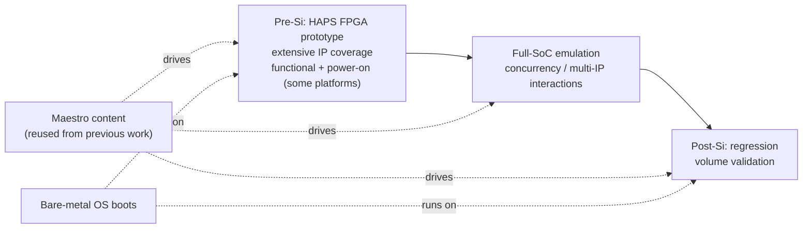

# Intel DSA IP Validation — NXNE

> **Role start:** 27 Jul 2026 · Intel · **NXNE** group · **DSA IP validation** for server (Xeon) platforms.
> Living workspace for onboarding notes, DSA fundamentals, validation-flow docs, and a running cadence journal.

---

## ⚠️ Confidentiality — read this first

This repo is pushed to a **public GitHub remote** (`github.com/fantops/silicon-val-prep`). Treat **everything committed here as public**.

- ✅ **Safe here:** publicly-documented DSA architecture (Intel DSA spec, Linux `idxd`, `accel-config`), generic validation methodology, your own conceptual learning notes.
- ❌ **Never here:** Maestro internal content, HAPS / emulation platform configs, RTL / microarchitecture internals, specific bug details, coverage numbers, unreleased product info, or anything from Intel-confidential docs.
- 🔒 **Internal-only notes** go in [`_internal/`](./_internal/) — that folder is **git-ignored** and stays on your machine. For anything truly sensitive, prefer Intel's internal systems over a local file.

> **Scope assumption:** *DSA = Intel **Data Streaming Accelerator*** — the on-die Xeon data-movement/transform accelerator (Sapphire Rapids onward). If your "DSA" means something else, say so and these docs get re-scoped.

---

## The validation flow (as you described it)

1. **Pre-Si — HAPS model** (Synopsys FPGA prototype): extensive IP coverage — functional, and **power-on** for some platforms.
2. **Full-SoC emulation model**: concurrency and cross-IP interactions that only surface when many agents run at once.
3. **Post-Si — regression**: high-volume validation on real silicon.
4. **Bare-metal OS boots** as a test vehicle across stages.
5. **Maestro content** carried over from previous work — same content framework, new IP target.

---

## What's here

| Path | Purpose |
|---|---|
| [`fundamentals/dsa_ip_fundamentals.md`](fundamentals/dsa_ip_fundamentals.md) | **Start here** — what DSA is, architecture, programming model, address translation, val surfaces (all public). |
| [`validation/validation_flow.md`](validation/validation_flow.md) | HAPS → emulation → post-Si regression, bare-metal boot, Maestro (placeholders for internal specifics). |
| [`journal/`](journal/) | Dated cadence entries. Copy the template, one file per session. |
| [`_internal/`](_internal/) | **Git-ignored.** Local-only landing spot for Maestro / platform / IP internals. |

---

## Cadence

Whatever cadence is possible — no fixed daily quota. The mechanism:

- One dated file per working session in [`journal/`](journal/), e.g. `2026-07-28_dayNN_topic.md`.
- Each entry: **what I did · what I learned · open questions · next**.
- When a concept matures, promote it out of the journal into `fundamentals/` or `validation/`.
- Day 1 seed: [`journal/2026-07-27_day01_onboarding.md`](journal/2026-07-27_day01_onboarding.md).

---

## Cross-links into your foundation plan

DSA reuses concepts you already built in [`../prep_plan/`](../prep_plan/README.md):

| DSA concept | Foundation day |
|---|---|
| DMA descriptors, doorbells, ordering, barriers | [Day 20 — DMA, doorbells, ordering, barriers](../prep_plan/day20_dma_doorbells_ordering_barriers.md) |
| IOMMU / VT-d, PASID, address translation | [Day 19 — TLB, huge pages, IOMMU/SMMU](../prep_plan/day19_tlb_huge_pages_iommu_smmu.md) |
| DMA-vs-CPU cache coherence | [Day 17 — Coherence, MESI, false sharing](../prep_plan/day17_coherence_mesi_false_sharing.md) |
| MMIO portals, `volatile`, polling, W1C | [Day 3 — Bits, MMIO, volatile, polling](../prep_plan/day03_bits_mmio_volatile_polling.md) |
| PCIe enumeration (DSA is a PCIe-enumerated device) | [Day 34 — PCIe enumeration, config, BARs, MSI](../prep_plan/day34_pcie_enumeration_config_msi.md) |
| PM intersection (idle gating / power-on) | [Day 27 — C-states, PkgC, S0ix](../prep_plan/day27_cstates_pkgc_s0ix.md) |

---

## Open questions to fill in (as you learn on the job)

- [ ] Which Xeon generation(s) / platform(s) are in scope?
- [ ] Which DSA operations are the coverage priority for your IP?
- [ ] SWQ vs DWQ focus? SIOV / virtualization in scope?
- [ ] What does Maestro provide vs. what you write (kept in `_internal/`)?
- [ ] Which platforms include the **power-on** pass on HAPS?
- [ ] Bare-metal boot target(s) and handoff to regression.
