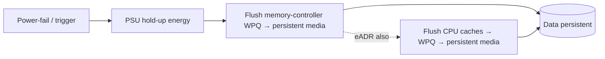
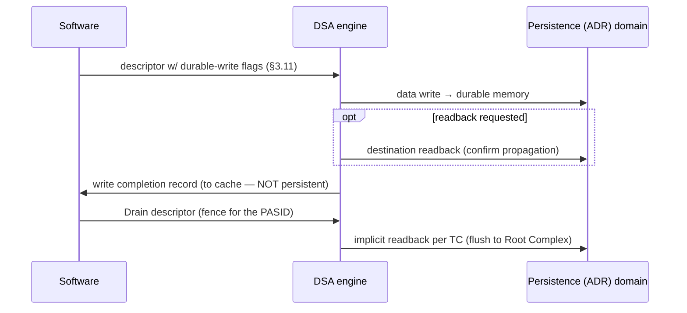

# DSA × ADR — Durable Writes & the Persistence Domain

> How DSA guarantees a write is **persistent** by the time a descriptor completes, and how that rides on the platform's **ADR (Asynchronous DRAM Refresh)** domain.
> DSA-specific facts are from the **public** Intel DSA Architecture Spec **Rev 3.0** (341204-006US), §2.2.1, §3.9–3.12. ADR/eADR platform behavior is generic public knowledge.
> **Public-only.** Platform hold-up numbers, DIMM specifics, internal sequences → git-ignored [`../_internal/`](../_internal/).

---

## 1. What ADR is (platform context)

**ADR = Asynchronous DRAM Refresh** — a platform power-fail mechanism that makes a bounded set of in-flight writes **durable** across a power loss, so persistent-memory software can rely on a **persistence domain**.

- On a power-fail / surprise-reset trigger, the platform uses **PSU hold-up energy** to complete an ordered flush before rails collapse.
- The memory controller flushes its **Write Pending Queues (WPQ)** to the persistent media (NVDIMM / battery- or capacitor-backed DRAM).
- **ADR domain** = everything guaranteed to reach persistence on power-fail. Classic ADR covers the **memory-controller WPQ**, *not* CPU caches.
- **eADR (enhanced ADR)** extends the domain to also flush **CPU caches** — so data that is merely globally observable (in cache) also becomes persistent.

> Mental model: a write is **durable** once it is inside the ADR domain. With ADR that means "in the WPQ / at the memory controller"; with eADR, "even if still in cache."

---

## 2. What DSA adds (spec §3.11 Persistent Memory Support)

DSA can **ensure data written by a descriptor has become persistent at the time the descriptor completes** — so software doesn't need a separate CPU-side flush + fence for DSA-produced writes. The control is in the descriptor's **cache-control flags**, gated by a capability bit.

| `GENCAP` **Durable Write Support** | How software requests a durable write | Readback? |
|---|---|---|
| **0** | Set **Cache Control 1 = 0** and **Cache Control 2 = 1** | **Yes** — also triggers a readback to the destination address on completion |
| **1** | Set **Cache Control 3 = 1**, and **Cache Control 1 = Cache Control 2 = 0** | **No** readback performed |

Key rules (straight from the spec):

- **Completion records are always directed to cache** → there is **no** device mechanism to make the *completion record* itself persistent. Only the *data* writes are made durable.
- The **Strict Ordering** flag does **not** guarantee that writes become persistent *in order*.
- Historical naming: **Cache Control 2 was previously "Destination Readback"**; **Cache Control 1 was previously "Cache Control."** Watch for this when reading older material.
- Which exact cache-control-flag combinations mean "durable" (and which are reserved) is enumerated in **§8.1.3.1** — read it against the flag encodings for your part.

---

## 3. Completion & ordering — when is it durable?

For **Drain** (§3.12) and completion ordering (§3.9), a preceding descriptor is "complete" only after, in order:

1. all data writes it produced are **globally observable**;
2. **destination readback** has occurred, *if requested*;
3. the **completion-record** write is globally observable, *if needed*;
4. the **completion interrupt** is generated, *if requested*.

To force writes out to the Root Complex, hardware normally issues an **implicit readback per Traffic Class** as part of Drain. Software can suppress the implicit readbacks and/or add **explicit readbacks** (up to 2 addresses) — needed for **peer (non-Root-Complex)** targets. Always `SFENCE`/`MFENCE` **before** submitting a Drain descriptor.

---

## 4. Why this matters for validation

DSA-durable-write correctness is a persistence-domain problem: the failure mode is **silent data loss on power-fail** if a "completed, durable" write wasn't actually in the ADR domain.

**Coverage surfaces**

- **Flag matrix:** every durable-write encoding for **both** `GENCAP` Durable Write Support = 0 and = 1 paths; reserved combinations rejected as specified (§8.1.3.1).
- **Readback-on-complete:** with DWS=0 path, confirm the destination readback actually occurs and that a **failed readback** is reported (write may not have succeeded).
- **Completion ordering:** data durable *before* the completion record is observed by software; interrupt after CR.
- **Completion record is NOT persistent** — negative test: don't let a test (or model) assume the CR survives power-fail.
- **Ordering caveat:** Strict Ordering must **not** be interpreted as persist-ordering — explicitly test that writes can become persistent out of order.
- **Drain / flush:** implicit per-TC readback flushes to Root Complex; explicit readbacks reach **peer** targets; `SFENCE`/`MFENCE` precedence.
- **Power-fail injection** (platform-dependent, → [`../_internal/`](../_internal/)): trigger ADR mid-stream; verify only the guaranteed set persists; distinguish **ADR vs eADR** domain scope (cache flushed or not).
- **Cross-node persistence:** durable write to **remote persistent memory across an NTB** — the write must be confirmed across the link *and* durable at the far node → see [`ntb_flow.md`](ntb_flow.md).

**Debug ladder (durability failure)**

1. Descriptor flags — correct durable-write encoding for this part's `GENCAP` Durable Write Support value?
2. Capability — is Durable Write Support actually set on this part/platform?
3. Readback — requested? did it complete? did a failed readback get reported?
4. Ordering — did software observe completion before durability was guaranteed (a false "done")?
5. Domain — ADR vs eADR: was the data in cache-only and lost because plain ADR doesn't flush caches?

---

## 5. Cross-links

- DSA core: [`dsa_ip_fundamentals.md`](dsa_ip_fundamentals.md) · Ramp-up: [`../ramp_up.md`](../ramp_up.md) · Cross-node: [`ntb_flow.md`](ntb_flow.md)
- Foundation: [Day 15 — Memory systems / DRAM](../../prep_plan/archive/day15_memory_systems_ecc.md) · [Day 20 — DMA, ordering, barriers](../../prep_plan/archive/day20_dma_doorbells_ordering_barriers.md) · [Day 27 — C-states / PkgC / power](../../prep_plan/archive/day27_cstates_pkgc_s0ix.md) · [Day 31 — Post-Si PM validation](../../prep_plan/archive/day31_post_si_pm_validation.md)

> **Confidentiality:** power-fail sequences, hold-up budgets, DIMM/platform specifics, and any silicon behavior beyond the public spec belong in git-ignored [`../_internal/`](../_internal/) — not here.
