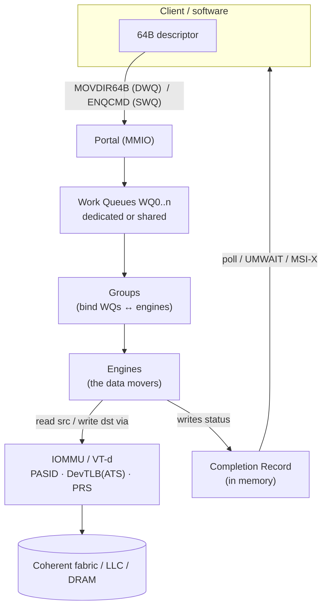
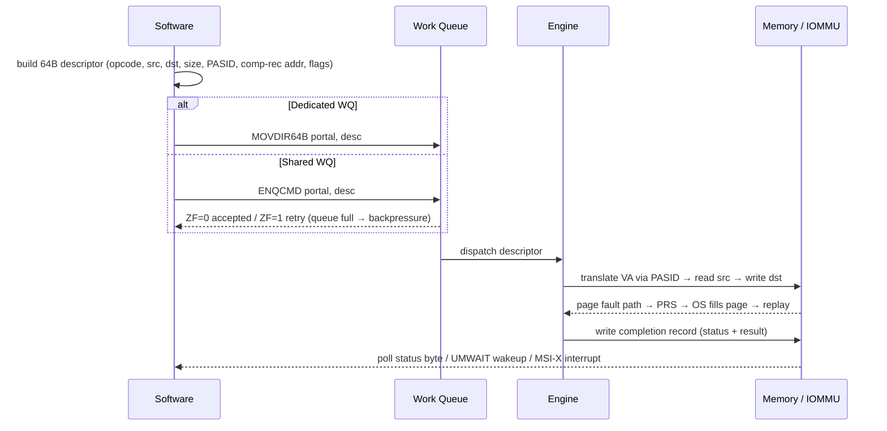

# Intel DSA — Data Streaming Accelerator: IP Fundamentals

> Public-knowledge primer (Intel DSA Architecture Spec, Linux `idxd`, `accel-config`, Intel DML). No internal content.
> Goal: understand the IP well enough to reason about **coverage**, **failure modes**, and **debug** on HAPS / emulation / post-Si.

---

## 1. What DSA is and why it exists

**DSA = Data Streaming Accelerator** — an on-die accelerator integrated into Intel Xeon Scalable server CPUs (**4th Gen "Sapphire Rapids" onward**; also Emerald Rapids, Granite Rapids). It **offloads bulk data movement and simple transforms** from the CPU cores.

- **Why:** a core doing a large `memcpy`/`memset` burns cycles + cache + power and stalls on memory. DSA does it in hardware, freeing the core and improving throughput/latency/energy for bulk ops.
- **Predecessor:** Crystal Beach DMA (CBDMA / "I/OAT", Linux `ioatdma`) in older Xeons. DSA is the modern, richer, user-space-submittable replacement.
- **Sibling accelerators** in the same family: **IAA** (In-memory Analytics Accelerator — compress/decompress/scan), **QAT** (QuickAssist — crypto/compression), **DLB** (Dynamic Load Balancer). DSA is the *data-mover*.
- **Typical uses:** `memcpy`/`memmove` offload, memory zeroing/fill, VM live-migration, checkpoint/restore, storage data-integrity (CRC/DIF), networking buffer moves, page migration, dedup/delta.

---

## 2. Where it sits in the SoC

- Presented to software as a **PCIe-enumerated device** — a Root-Complex Integrated Endpoint (RCIEP) — even though it's on-die. So it has PCIe config space, BARs, and MSI-X. → ties to [Day 34 — PCIe enumeration](../../prep_plan/day34_pcie_enumeration_config_msi.md).
- Sits on the **mesh/uncore**; its reads/writes go through the **coherent fabric** (LLC / memory controllers). → coherence matters, [Day 17](../../prep_plan/day17_coherence_mesi_false_sharing.md).
- Uses the **IOMMU (Intel VT-d)** for address translation and isolation. → [Day 19 — IOMMU/SMMU](../../prep_plan/day19_tlb_huge_pages_iommu_smmu.md).

---

## 3. Architectural building blocks

| Block | What it is |
|---|---|
| **Descriptor** | The unit of work — a **64-byte** structure: opcode, flags, source addr, dest addr, size, completion-record addr, PASID, etc. |
| **Work Queue (WQ)** | On-device queue that holds submitted descriptors. Two modes below. |
| **Engine** | The hardware data mover that actually executes descriptors. |
| **Group** | Binds one or more WQs to one or more engines (routing + QoS/bandwidth). |
| **Portal** | The MMIO address a client writes a descriptor to, to submit it. |
| **Completion Record (CR)** | Memory location the engine writes status/result to; software polls or waits on it. |
| **Batch descriptor** | A single descriptor pointing at an **array of descriptors** — amortizes submission cost for many small ops. |

### Dedicated vs Shared work queues (a key val axis)

| | **Dedicated WQ (DWQ)** | **Shared WQ (SWQ)** |
|---|---|---|
| Clients | One at a time | Many concurrent clients |
| Submit instruction | `MOVDIR64B` | `ENQCMD` (user) / `ENQCMDS` (supervisor) |
| Backpressure | **None** — SW must not overflow | Device returns **accept/retry** (ZF flag) |
| Typical user | Kernel / single owner | User-space, multi-tenant (with PASID) |

---

## 4. Operation types (opcodes)

| Category | Operations |
|---|---|
| Control | No-op, **Batch**, **Drain** (fence/flush) |
| Move | **Memory Move** (memcpy), **Fill** (memset) |
| Compare | **Compare**, **Compare Pattern** |
| Delta | **Create Delta Record**, **Apply Delta Record** |
| Multi-dest | **Dualcast** (copy to two destinations) |
| Integrity | **CRC Generation**, **Copy with CRC**, **DIF** Insert / Strip / Update / Check (T10 storage data-integrity) |
| Cache | **Cache Flush** / cache-control hints (destination write-back vs write-through, "no allocate") |

> Each op × size × alignment × boundary-crossing (cache line, page) is a coverage dimension. See §9.

---

## 5. The programming model (submission path)

**Steps:**
1. **Enumerate** the device (PCIe config, BARs, capability registers: `GENCAP`, `WQCAP`, `GRPCAP`, `ENGCAP`).
2. **Configure** engines, groups, WQ mode/size/priority (via `idxd` / `accel-config`), then **enable** device + WQs.
3. Client **maps a portal** (mmap of the WQ's MMIO page).
4. **Build** the 64-byte descriptor.
5. **Submit:** `MOVDIR64B` (DWQ) or `ENQCMD` (SWQ, check ZF for retry).
6. **Wait for completion:** poll the CR status byte · `UMONITOR`/`UMWAIT` (power-efficient wait) · MSI-X/IMS interrupt.
7. **Check status**, handle faults (page fault → PRS replay, or error status → restart/report).

---

## 6. Address translation & sharing (the tricky val surface)

This is where DSA is much more than a DMA engine, and where a lot of functional bugs live.

| Mechanism | Meaning |
|---|---|
| **PASID** (Process Address Space ID) | Tags each descriptor with an address space, so **user-space** can submit descriptors that use **virtual addresses**. |
| **SVM** (Shared Virtual Memory) | Device shares the process's virtual address space — no buffer pinning or bounce-copy. |
| **IOMMU / Intel VT-d** | Translates device VA→PA and enforces per-PASID isolation. → [Day 19](../../prep_plan/day19_tlb_huge_pages_iommu_smmu.md). |
| **ATS + DevTLB** | Device caches translations locally (Address Translation Services). Invalidation correctness = a coverage item. |
| **PRS / PRI** (Page Request Services) | On a not-present page, device **faults**, IOMMU asks the OS to page it in, then the op **replays**. Faultable DMA is a major DSA differentiator — and a rich bug surface. |

Two operating styles:
- **Shared / SVM:** user-space, PASID-tagged, faultable (uses PRS). Flexible, more corner cases.
- **Dedicated / kernel:** pinned buffers, physical/kernel addressing. Simpler, fewer fault paths.

---

## 7. Instruction cheat-sheet

| Instruction | Role |
|---|---|
| `MOVDIR64B` | 64-byte direct store → submit to a **dedicated** WQ portal (weakly ordered). |
| `ENQCMD` / `ENQCMDS` | Enqueue command → submit to a **shared** WQ; sets **ZF=1** if not accepted (retry). `ENQCMDS` is the supervisor form. |
| `UMONITOR` / `UMWAIT` / `TPAUSE` | Power-efficient wait on the completion record (avoids a busy spin). |
| `MOVDIRI` | Direct-store of a doubleword (related primitive; not DSA-specific). |

---

## 8. Software stack

- **Kernel:** `idxd` driver (a.k.a. Intel Data Accelerator driver / `dsa`). Exposes `/sys/bus/dsa/`.
- **Userspace config:** `accel-config` + `libaccel-config` — create/configure/enable devices, groups, engines, WQs.
- **App libraries:** **Intel DML** (Data Mover Library), plus **DPDK** and **SPDK** integrations for networking/storage.
- **Virtualization:** **SIOV** (Scalable IOV) with **IMS** interrupts — assign WQs (as mdev/VF) to guest VMs. → concurrency & isolation coverage.

---

## 9. Why validation is non-trivial — coverage surfaces

Group the space so a vplan writes itself:

- **Functional (per op):** every opcode × size (0, 1, cache-line, page, huge, max) × src/dst alignment × **cache-line- and page-boundary crossing** × overlapping vs non-overlapping regions.
- **Submission:** DWQ (`MOVDIR64B`) vs SWQ (`ENQCMD`); ENQCMD **retry/backpressure** under queue-full; batch descriptors; drain/fence ordering.
- **Address translation:** PASID correctness; SVM; **page-fault via PRS** (present/not-present, replay); DevTLB/IOTLB **invalidation**; access-permission faults.
- **Completion & interrupts:** polling vs `UMWAIT` vs **MSI-X / IMS**; completion **ordering**; status/error encodings.
- **Integrity ops:** CRC and **DIF** insert/strip/update/check — including injected mismatches.
- **Error injection:** bad/unmapped address, misalignment, poisoned/UC memory, DIF/CRC mismatch, WQ overflow, PASID misconfig.
- **QoS / concurrency:** multiple engines × WQs × groups; fairness, bandwidth split, head-of-line blocking, deadlock freedom.
- **Power:** IP clock/power gating when idle, and the **power-on** pass (some platforms). → [Day 27](../../prep_plan/day27_cstates_pkgc_s0ix.md).
- **Virtualization:** SIOV, VF/mdev assignment, guest isolation.
- **Coherence/ordering:** DMA vs CPU caches; correct barriers before doorbell/submit. → [Day 20](../../prep_plan/day20_dma_doorbells_ordering_barriers.md), [Day 17](../../prep_plan/day17_coherence_mesi_false_sharing.md).

---

## 10. Concurrency — why a full-SoC emulation model

Many bugs are invisible to a single-descriptor unit test and only appear when **many agents run at once**:

- Multiple **engines + WQs + clients** + IOMMU + mesh + memory controllers interacting.
- **Head-of-line blocking**, fairness/starvation across groups, ordering hazards, **deadlocks**.
- Translation caches under churn (concurrent PRS faults + invalidations).
- Cross-IP interactions (DSA + PCIe + memory + PM) that a HAPS IP-block view can't fully see.

That concurrency + cross-IP surface is exactly what the **full-SoC emulation** stage targets, after HAPS has driven **breadth of per-IP functional coverage**.

---

## 11. One-paragraph explanation (say this out loud)

> DSA is Intel's on-die data-streaming accelerator in Xeon that offloads bulk memory moves and simple transforms — memcpy, fill, compare, delta, dualcast, CRC/DIF — from the cores. Software builds a 64-byte descriptor and submits it to a work queue: `MOVDIR64B` for a dedicated queue, or `ENQCMD` for a shared queue where the device signals accept-or-retry. An engine executes it, translating addresses through the IOMMU with a PASID so user-space can submit virtual addresses, page-faulting through PRS when needed, then writes a completion record that software polls or waits on. Validation-wise the interesting surfaces are the op × size × alignment × boundary matrix, shared-queue backpressure, PASID/SVM page-fault handling, completion ordering, error injection, and — under full-SoC concurrency — fairness, ordering, and deadlock freedom across many engines and clients.

---

### Cross-links
- Foundation: [Day 20 DMA/ordering](../../prep_plan/day20_dma_doorbells_ordering_barriers.md) · [Day 19 IOMMU](../../prep_plan/day19_tlb_huge_pages_iommu_smmu.md) · [Day 17 coherence](../../prep_plan/day17_coherence_mesi_false_sharing.md) · [Day 3 MMIO](../../prep_plan/day03_bits_mmio_volatile_polling.md) · [Day 34 PCIe enum](../../prep_plan/day34_pcie_enumeration_config_msi.md)
- Next in this folder: [validation flow & platforms](../validation/validation_flow.md)
