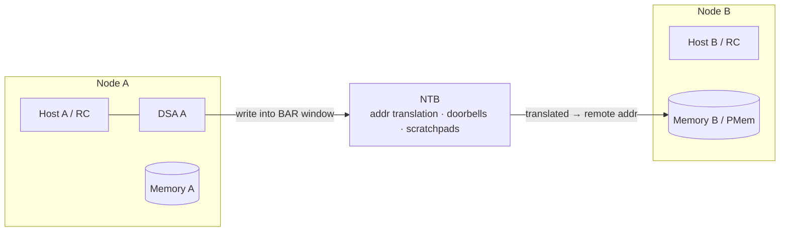
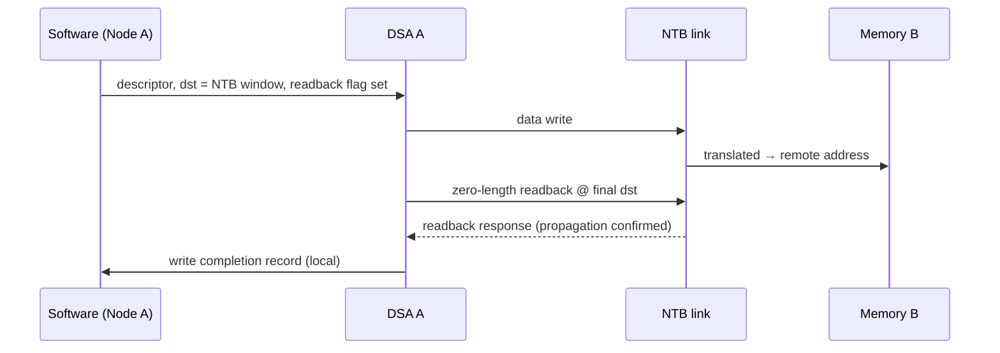

# DSA × NTB — Cross-Node Data Movement

> How DSA moves data **through a Non-Transparent Bridge (NTB)** to/from another node's memory, and how it confirms the write crossed the link.
> DSA-specific facts are from the **public** Intel DSA Architecture Spec **Rev 3.0** (341204-006US), §2, §2.1, §3.9, §3.12, §3.14. NTB fundamentals are generic public PCIe knowledge.
> **Public-only.** Platform NTB topology, BAR maps, internal bring-up → git-ignored [`../_internal/`](../_internal/).

---

## 1. What an NTB is (PCIe context)

A **Non-Transparent Bridge** connects **two independent PCIe hierarchies** (two root complexes / two hosts) while **isolating** their enumeration domains. Unlike a *transparent* bridge (which forwards config cycles so one host enumerates everything), each side of an NTB sees the other as an **endpoint**, not as a path to the other host's devices.

- **Isolation:** neither host enumerates or owns the other's memory map — each side owns its own.
- **Address translation windows:** memory is shared through **BAR windows** whose addresses are **translated** (via a translation/LUT) from the local side into the remote side's address space.
- **Doorbells:** inter-host interrupts — one side rings a doorbell, the other takes an interrupt.
- **Scratchpad registers:** small shared registers both sides can read/write for control-plane handshake.

**Use cases:** host-to-host clustering, **high-availability failover** (mirror state to a standby node), **storage appliances** that move data across nodes, and inter-node messaging.

---

## 2. What DSA adds (spec §2, §2.1)

The DSA spec calls out NTB as a **first-class target**:

> "Intel DSA hardware supports high-performance data mover capability to/from volatile memory, persistent memory, memory-mapped I/O, **and through a Non-Transparent Bridge (NTB) in the SoC to/from remote volatile and persistent memory on another node in a cluster**."

And in the **Storage** usage: data movement "both within the node and **across nodes using Non-Transparent Bridge (NTB)**," with or without simultaneous CRC/DIF generation.

So DSA offloads the actual **cross-node copy**: the descriptor's destination (or source) address lands in an **NTB BAR window**, and the bridge translates it into the remote node's memory. The core is freed from driving the cross-node move.

---

## 3. Destination readback — confirming the write crossed the link (§3.9)

A cross-node write is "done" locally long before it has actually **propagated across the NTB link**. DSA closes that gap with **destination readback**:

- Certain **cache-control-flag** combinations request a **destination readback** (§8.1.3.1).
- The engine issues a **zero-length read** to the descriptor's **final destination address** *before* writing the completion record.
- Because the destination target (across the NTB) differs from the completion-record target (local), the readback **ensures the data has propagated to the destination** before the CR is written.
- The spec's own example: *"this flag may be used in descriptors that target NTB to ensure that data written by the descriptor has propagated across the NTB link."*
- Readback is performed **only on successful completion** — not on a partial (page-faulted) completion.

For broader flushing, a **Drain** descriptor (§3.12) issues implicit per-Traffic-Class readbacks to flush writes to the **Root Complex**; writes to a **peer / non-Root-Complex** target (i.e., across the NTB to another node) may need **explicit readbacks** — the Drain descriptor allows up to **2 explicit readback addresses**.

---

## 4. Inter-domain vs NTB — related, not the same (§3.14)

Both move data "somewhere the submitter doesn't natively address," so keep them distinct:

| | **Inter-Domain** (§3.14) | **NTB** (§2) |
|---|---|---|
| Crosses | A different **address space (PASID)** on the **same** node | A different **node / root complex** |
| Mechanism | **IDPT** entries + **memory windows** + access PASID | PCIe **BAR translation windows** in the bridge |
| Set-up | Kernel driver programs IDPTE (SASS / SAMS), owner exposes a window | Platform configures NTB windows/LUT, doorbells, scratchpads |
| Composes with | — | **Yes** — inter-domain move whose window resolves into an NTB window reaches a remote domain |

Inter-domain essentials (for when your cross-node move is also cross-address-space):

- A descriptor names an **alternate address space** via a **handle** into the **Inter-Domain Permissions Table (IDPT)**; the entry supplies the **access PASID**, the **memory window** (base/size, Address or Offset mode), and R/W permissions.
- **IDPTE types:** **SASS** (one access PASID, one submitter) and **SAMS** (one access PASID, many submitters via a **submitter bitmap**).
- The **descriptor PASID** is always used for the completion record, interrupts, and permission checks; the **access PASID** is used for the aliased data accesses.
- **Update Window** atomically changes window attributes and does an **implicit drain** of in-flight descriptors using the old attributes.

---

## 5. Why this matters for validation

The failure modes are **wrong-node / wrong-address writes** (translation bug) and **false completion** (CR written before data actually crossed the link).

**Coverage surfaces**

- **NTB window translation:** local address in the BAR window lands at the **correct** remote address; boundary and window-size edges; out-of-window rejected.
- **DSA move across NTB:** Memory-Move (± CRC/DIF) with destination in an NTB window; verify remote bytes at Node B.
- **Destination readback:** with the readback flag, completion is signalled **only after** propagation; a **failed** readback is surfaced (write may not have landed).
- **Drain explicit readbacks:** peer/NTB targets flushed via explicit readback addresses (implicit per-TC readback only guarantees Root-Complex writes).
- **Remote persistent memory:** durable write to **remote PMem** across the NTB — confirmed across the link **and** durable at the far node → [`adr_flow.md`](adr_flow.md).
- **Inter-domain composition:** access-PASID + memory-window checks (Address vs Offset mode); Update Window atomicity + implicit drain; permission-denied and bad-handle cases reported with the IDPT handle.
- **Error / link cases:** NTB link down / timeout, translation miss, partial completion + replay; ordering under concurrency (multiple engines targeting the same window).
- **Doorbell / scratchpad handshake** (platform, → [`../_internal/`](../_internal/)): control-plane signalling around the data move.

**Debug ladder (cross-node move failed)**

1. Completion record — success, error code, or nothing (hang)?
2. Readback — requested? completed? did a failed readback flag the write?
3. Address — did the descriptor's destination fall inside the NTB window; correct translation to the remote address?
4. Inter-domain (if used) — valid IDPT handle, submitter allowed, address within the window, R/W permission?
5. Link — NTB up? propagation actually crossed (peer readback) vs just reached local Root Complex?

---

## 6. Cross-links

- DSA core: [`dsa_ip_fundamentals.md`](dsa_ip_fundamentals.md) · Ramp-up: [`../ramp_up.md`](../ramp_up.md) · Persistence: [`adr_flow.md`](adr_flow.md)
- Foundation: [Day 20 — DMA, ordering, barriers](../../prep_plan/archive/day20_dma_doorbells_ordering_barriers.md) · [Day 33 — PCIe fundamentals / LTSSM](../../prep_plan/archive/day33_pcie_fundamentals_ltssm.md) · [Day 34 — PCIe enumeration, config, BARs, MSI](../../prep_plan/archive/day34_pcie_enumeration_config_msi.md)

> **Confidentiality:** NTB topology, BAR/LUT maps, platform bring-up steps, and any behavior beyond the public spec belong in git-ignored [`../_internal/`](../_internal/) — not here.
