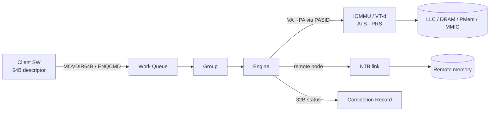
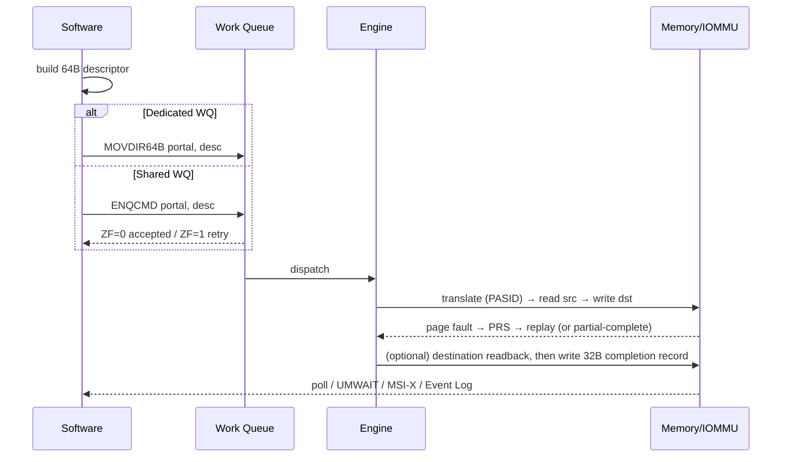

# DSA — Fast Ramp-Up

> Get productive on **Intel DSA (Data Streaming Accelerator)** validation fast.
> Grounded in the **public** Intel DSA Architecture Specification — **Rev 3.0**, order no. **341204-006US**, June 2025 (local copy: [`341204-006-intel-data-streaming-accelerator-spec.pdf`](341204-006-intel-data-streaming-accelerator-spec.pdf)).
> **Public-only page.** Maestro / platform / RTL / bug specifics → git-ignored [`_internal/`](_internal/).

This is the one-page on-ramp. Depth lives in [`fundamentals/`](fundamentals/) and [`validation/`](validation/).

---

## 0. How to use this page

1. Read the **mental model** (§1) and the **10 things** (§2) once — that's the vocabulary.
2. Skim the spec in the **reading order** (§4) — don't read 288 pages linearly.
3. Keep the **register** (§6) and **instruction** (§7) cheat-sheets open while reading Ch 8–9.
4. Bring up your **first flows** (§10) on bare-metal, then widen coverage from [`validation/validation_flow.md`](validation/validation_flow.md).

---

## 1. Mental model (say this out loud)

> DSA is Intel's on-die data-streaming accelerator in Xeon that offloads bulk memory moves and transforms — move, fill, compare, delta, dualcast, CRC/DIF, **scatter-gather**, and **type-convert/reduce** — off the cores. Software builds a **64-byte descriptor** and submits it to a **work queue**: `MOVDIR64B` for a **dedicated** WQ, or `ENQCMD` for a **shared** WQ where the device signals accept-or-retry. An **engine** executes it, translating addresses through the IOMMU with a **PASID** (so user-space can pass virtual addresses), page-faulting via **PRS** when needed, then writes a **32-byte completion record** that software polls or waits on. Newer silicon adds **inter-domain** moves (across address spaces), movement **through an NTB** to another node's memory, and **durable writes** into the persistence (**ADR**) domain.

---

## 2. The 10 things to internalize first

1. **Unit of work = 64B descriptor** (opcode, src, dst, size, PASID, completion-record addr, flags).
2. **Two submission paths:** dedicated WQ (`MOVDIR64B`, no backpressure) vs shared WQ (`ENQCMD`, ZF = accept/retry).
3. **Building blocks:** Descriptor → WQ → **Group** (binds WQs↔engines) → **Engine** → memory; status in a **Completion Record (32B)**.
4. **Completion signalling:** poll CR status byte · `UMONITOR`/`UMWAIT`/`TPAUSE` · MSI-X/IMS interrupt · (newer) **Event Log**.
5. **Address translation:** IOMMU/VT-d + **PASID** + **SVM**; **ATS**/ATC (Device TLB); faultable via **PRS**.
6. **Two page-fault modes:** *partial descriptor completion* (stop + report progress) vs *Block on Fault* (wait + continue).
7. **Batch:** one Batch descriptor points at an array of descriptors — amortizes submission (Rev 3.0 allows **single-entry** batch).
8. **Cache-control flags** steer data placement and enable **destination readback** and **durable (persistent) writes**.
9. **Inter-domain:** a descriptor can name an **alternate address space** (access PASID) via the **IDPT** + memory windows.
10. **Cross-node:** DSA can move to/from **remote memory across an NTB**; **destination readback** confirms the write crossed the NTB link.

---

## 3. Where DSA sits (SoC context)

Presented as a **PCIe-enumerated** root-complex integrated endpoint (config space, BARs, MSI-X) even though it's on-die.

---

## 4. Read the spec in this order (341204-006, Rev 3.0)

| Order | Read | Why |
|---|---|---|
| 1 | **Ch 2 Overview** (§2.2 features, Table 2-1 data ops, Table 2-2 control ops) | The whole feature map on ~4 pages. |
| 2 | **Ch 3 Architecture** §3.1–3.9 (WQ/engine/group, descriptor processing, ordering) | How work flows through the device. |
| 3 | **§3.10 Cache Control** + **§3.11 Persistent Memory** + **§3.12 Drain** | Data placement, **durable writes (ADR)**, fencing. |
| 4 | **§3.13 Address Translation** (ATS/PRS, partial-vs-block-on-fault, per-WQ ATS/PRS) | The richest functional bug surface. |
| 5 | **§3.14 Inter-Domain** (IDPT, memory windows, Update Window) | Cross-address-space + the NTB story. |
| 6 | **Ch 5 Event Log** | Scalable completion/fault reporting. |
| 7 | **Ch 8 Descriptors & Operations** (§8.1 descriptor, §8.1.3 cache-control flags, §8.3 per-op) | Field-level truth for every opcode. |
| 8 | **Ch 9 Registers** (GENCAP/WQCAP/GRPCAP/OPCAP/IDCAP/EVLCFG/DSACAP0-2…) | Enumerate → configure → enable. |
| 9 | **Ch 7 Virtualization / SIOV** | Only if SIOV/guest assignment is in your scope. |

---

## 5. What changed in Rev 3.0 (quick delta)

| Rev | Highlights |
|---|---|
| **3.0** (Jun 2025) | **Scatter-Gather**; **Type Conversion** + **Reduce** (compute/AI-HPC); per-group **Read/Write Bandwidth Limit** in `GRPCFG`; **single-entry Batch**; extended cache-control flags; `DSACAP0/1/2` registers. |
| 2.1 (Oct 2024) | Removed Inter-Domain Cache Flush; errata. |
| 2.0 (Sep 2022) | **Inter-domain** ops + `IDCAP`/IDPT/submitter-bitmap; **Event Log**; per-WQ `OPCFG`; **Translation Fetch**; engine pipeline-depth control; WQ PRS Disable. |

Full table + coverage impact: [`fundamentals/dsa_ip_fundamentals.md`](fundamentals/dsa_ip_fundamentals.md#whats-new-across-dsa-generations).

---

## 6. Register cheat-sheet (start here in Ch 9)

| Register | Role |
|---|---|
| `GENCAP` / `GENCFG` | General capabilities / config — incl. **Durable Write Support**, **Inter-Domain Support**, Block-on-Fault support. |
| `WQCAP` / `WQCFG` | Work-queue capabilities / per-WQ config (mode, size, priority, **WQ ATS/PRS Disable**, PASID). |
| `GRPCAP` / `GRPCFG` | Group capabilities / config — WQ↔engine binding, **Read/Write Bandwidth Limit** (Rev 3.0). |
| `ENGCAP` | Engine capabilities. |
| `OPCAP` / `OPCFG` | Supported operations (device-wide / **per-WQ**). |
| `CMDCAP` / `CMD` | Command capabilities / command register (enable/disable/drain/abort, Request IDPT Handle…). |
| `IDCAP` / `IDBR` | Inter-domain capabilities / submitter-bitmap read control. |
| `EVLCFG` / `EVLSTATUS` | Event Log configuration / status. |
| `DSACAP0/1/2` | Rev 3.0 capability registers (e.g., *Operations with Inter-Domain Support* in `DSACAP0`). |
| `SWERROR` / `INTCAUSE` | Software error log / interrupt cause. |

---

## 7. Instruction cheat-sheet

| Instruction | Role |
|---|---|
| `MOVDIR64B` | 64-byte direct store → submit to a **dedicated** WQ portal (weakly ordered). |
| `ENQCMD` / `ENQCMDS` | Enqueue command → **shared** WQ; **ZF=1** ⇒ not accepted (retry). `ENQCMDS` = supervisor form. |
| `UMONITOR` / `UMWAIT` / `TPAUSE` | Power-efficient wait on the completion record (avoid busy-spin). |
| `SFENCE` / `MFENCE` | Order stores before a **Drain** descriptor / doorbell. |

---

## 8. The submission → completion loop

1. **Enumerate** (PCIe config, BARs, `GENCAP`/`WQCAP`/`GRPCAP`/`ENGCAP`/`OPCAP`).
2. **Configure** engines, groups, WQ mode/size/priority; **enable** device + WQs.
3. **Map** a WQ portal (mmap MMIO page).
4. **Build** the 64B descriptor.
5. **Submit** (`MOVDIR64B` / `ENQCMD` — check ZF).
6. **Wait** on the completion record; **check status**, handle faults.

---

## 9. Where ADR & NTB fit (your extra scope)

- **ADR (Asynchronous DRAM Refresh)** — the platform **persistence domain**. DSA's **durable-write** cache-control flags (§3.11) make a write durable *by the time the descriptor completes*. Full flow + coverage: [`fundamentals/adr_flow.md`](fundamentals/adr_flow.md).
- **NTB (Non-Transparent Bridge)** — DSA moves data **through an NTB to/from another node's** memory (§2, §2.1). **Destination readback** (§3.9) confirms the write crossed the NTB link before completion. Full flow + coverage: [`fundamentals/ntb_flow.md`](fundamentals/ntb_flow.md).
- **Inter-domain** ops (§3.14) are the cross-*address-space* cousin; they compose with NTB for cross-*node* movement.

---

## 10. Validation on-ramp — first flows

Bring these up in order (bare-metal first for determinism — ties to [Day 3 MMIO](../prep_plan/day03_bits_mmio_volatile_polling.md), [Day 20 DMA/ordering](../prep_plan/day20_dma_doorbells_ordering_barriers.md)):

- [ ] **Enumerate + capability dump** — read `GENCAP`/`WQCAP`/`OPCAP`/`DSACAP0-2`; confirm which ops/features this part supports.
- [ ] **Configure + enable** one **dedicated** WQ in one group/engine.
- [ ] **Smoke Memory-Move** — small, aligned; `MOVDIR64B`; poll CR; verify bytes.
- [ ] **Widen the matrix** — size {0,1,line,page,huge,max} × alignment × line/page-crossing × overlap (fundamentals §9).
- [ ] **Shared WQ** — `ENQCMD` accept/retry under queue-full backpressure.
- [ ] **Faults** — PRS page-fault + replay; partial-completion vs Block-on-Fault.
- [ ] **Integrity** — CRC / DIF insert-strip-update-check (+ injected mismatch).
- [ ] **Durable write** — §3.11 flag matrix → [`adr_flow.md`](fundamentals/adr_flow.md).
- [ ] **Cross-node** — move across NTB + destination-readback → [`ntb_flow.md`](fundamentals/ntb_flow.md).
- [ ] **Concurrency** (emulation) — many engines/WQs/clients: fairness, ordering, deadlock-freedom.

---

## 11. Acronym glossary (from the spec)

| Acronym | Term |
|---|---|
| **ATS / ATC** | Address Translation Services / Address Translation Cache (= Device TLB) |
| **PRS / PRI** | Page Request Service / Interface (faultable DMA) |
| **PASID** | Process Address Space ID |
| **SVM** | Shared Virtual Memory |
| **WQ / DWQ / SWQ** | Work Queue / Dedicated / Shared |
| **WD / BD** | Work Descriptor / Batch Descriptor |
| **CR** | Completion Record (32 bytes) |
| **IDPT / IDPTE** | Inter-Domain Permissions Table / entry |
| **SASS / SAMS** | Single-Access-Single-Submitter / Single-Access-Multi-Submitter IDPTE types |
| **SIOV / IMS** | Scalable I/O Virtualization / Interrupt Message Store |
| **ADR / eADR** | Asynchronous DRAM Refresh / enhanced ADR |
| **NTB** | Non-Transparent Bridge |
| **TC** | Traffic Class |

---

## 12. Doc map

| Doc | Purpose |
|---|---|
| [`fundamentals/dsa_ip_fundamentals.md`](fundamentals/dsa_ip_fundamentals.md) | Architecture + programming model + coverage surfaces (Rev 3.0). |
| [`fundamentals/adr_flow.md`](fundamentals/adr_flow.md) | Durable writes → ADR/eADR persistence domain. |
| [`fundamentals/ntb_flow.md`](fundamentals/ntb_flow.md) | Cross-node data movement over NTB. |
| [`validation/validation_flow.md`](validation/validation_flow.md) | HAPS → emulation → post-Si + coverage checklist + debug ladder. |
| [`journal/`](journal/) | Dated cadence entries. |

> **Confidentiality:** everything committed here is public. Internals → git-ignored [`_internal/`](_internal/). If it isn't in a public Intel document, it doesn't belong in a tracked file.
