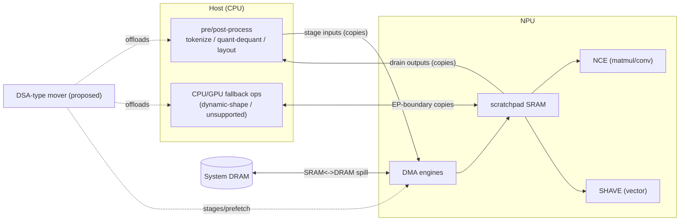

# Paper idea — DSA-offloaded AI inference data plane (cross-IHV)

> **Tracked in the private repo** (`fantops/silicon-val-prep`, private + 2FA). Public-source only — **no Intel-internal data**.
> Working notes for the Aug 7 VLSI-Design idea pitch + the Dec 2026 IEEE full paper.
> Confidentiality: genericize internal tool names, use public benchmarks/models for any numbers, keep Intel internals in git-ignored `_internal/`, and route through Intel publication clearance before submission.
> **Two papers:** (1) **Aug 7 near-term** = *DSA-type mover + NPU* concept (next section); (2) **Dec 2026 long** = the broad DSA-offloaded data-plane thesis (rest of doc).

---

## NEAR-TERM PAPER (Aug 7) — a DSA-type mover as the NPU's data-plane companion

**Thesis:** the NPU is engineered to *maximize compute density and minimize SRAM↔DRAM traffic*, but
inference is still gated by a **host-side data plane** (pre/post-processing, quant/dequant, layout
conversion, input staging, and CPU/GPU fallback copies). A **DSA-type data-streaming mover**, integrated
on the client SoC as a companion to the NPU, offloads that data plane — overlapping data movement with
NPU compute to free CPU cycles and cut inference latency/energy. (Intel DSA is the concrete exemplar of
the mover class; it ships on Xeon today, so on the client this is an *architecture proposal* backed by a
real opportunity measurement.)

### Intel NPU architecture (public)
Sources: Intel NPU Acceleration Library (github.com/intel/intel-npu-acceleration-library); OpenVINO NPU
device docs (docs.openvino.ai).

- Integrated AI accelerator in **Intel Core Ultra** (client). Meteor Lake = **NPU 3720**; Lunar Lake = **NPU 4** (higher TOPS — verify exact figure).
- **Compute:** **Neural Compute Engines (NCE)** = fixed-function MAC arrays for **matmul + convolution**; **SHAVE** (Streaming Hybrid Architecture Vector Engines) = programmable **vector/DSP** for general/elementwise ops.
- **Data movement:** on-NPU **DMA engines** move data between **system DRAM** and a **managed cache / scratchpad SRAM**; **MMU + IOMMU** for translation & isolation.
- **Dataflow:** the UMD **compiler tiles** the network to keep data resident in **SRAM**, explicitly **minimizing SRAM↔DRAM transfers** for perf/power.
- **Precision:** HW compute is **FP16**; supports FP32/FP16 and **INT8 (U8)** quantized (or mixed).
- **Key limitation:** **static shapes only** today → dynamic-shape workloads (LLM variable sequence length) need host-side padding/reshape or **CPU/GPU fallback**.
- Programmed via **OpenVINO** NPU plugin / **DirectML**; AUTO/HETERO can split a model across NPU+CPU+GPU (fallback for unsupported ops).

### Where a DSA-type mover helps (offload map)
| NPU-adjacent data-plane pain | DSA-type mover op |
|---|---|
| Quant / dequant (INT8 ↔ FP16) | **Type Conversion** |
| Host↔NPU layout / format conversion | Type Conversion / Memory Move |
| Embedding gather; tiling gather/scatter | **Scatter-Gather** |
| Weight streaming / activation spill staging (hide SRAM↔DRAM) | Memory Move / Dualcast (double-buffer) |
| Input staging / output drain (host↔NPU buffers) | Memory Move |
| CPU/GPU fallback & HETERO EP-boundary copies | Memory Move |
| Pooling / elementwise reductions | **Reduce** |

### Measure the opportunity on real client hardware (no DSA needed — feasible now)
- **HW:** an **Intel Core Ultra** laptop (Meteor/Lunar Lake) with NPU — widely available.
- **SW:** **OpenVINO** NPU plugin + a small model (ResNet / Whisper / TinyLlama / Phi); `ov::enable_profiling`; CPU util & energy via Intel **PCM** / PresentMon / `perf`.
- **Measure:** the **host-side data-plane fraction** of end-to-end inference (pre/post + quant + staging + fallback copies) vs NPU compute → **quantifies the offload opportunity** without needing DSA.
- **Then:** propose the DSA-type mover offload and **estimate** cycles/latency/energy saved (analytical). Long paper: prototype the offload on a DSA-capable path.

### Honest platform note (put it in the paper)
DSA (server/Xeon) and the NPU (client) are not co-located today. So the near-term paper is an
**architecture proposal + opportunity measurement**: profile the real NPU host-side data-plane tax, then
argue a **DSA-class companion mover** on the client SoC (or an elevation of the existing client iDMA to
DSA-class programmability) would relieve it — forward-looking, but grounded in measured data.

### Aug 7 deliverable
Idea/position + 1 slide: the NPU dataflow figure, the offload map, and (if you can grab a Core Ultra) a
single measured bar — "host data-plane tax vs NPU compute". No DSA hardware required.

---

# =========  LONG PAPER (Dec 2026)  =========

## The one-paragraph pitch (say this to the team)

Across Intel / AMD / Qualcomm on-device inference, a large and growing share of latency, energy,
and memory traffic is **not** matrix compute — it is the **data plane**: quantize/dequantize,
tensor layout & type conversion, embedding gather, KV-cache movement, and copies across
execution-provider (EP) boundaries including CPU fallback. From cross-IHV KPI-validation work
(performance / accuracy / memory) we can characterize this **"data-plane tax."** We argue it should
be **offloaded to a data-streaming accelerator**, and we observe that **Intel DSA Rev 3.0** added the
exact primitives — **Type Conversion, Reduce, Scatter-Gather** (plus Memory Move / Dualcast / Fill) —
that map onto these data-plane operations, freeing CPU/NPU cycles for compute. We propose a
**cross-IHV evaluation-and-validation framework** and a research agenda for accelerator-offloaded
inference data planes. DSA is the concrete, most-capable exemplar of a general mover class; the
framework generalizes across IHVs.

---

## Platform reality — get this right (or reviewers will bite)

Today, on Intel, **DSA and the NPU do not co-exist on one die**:
- **DSA** ships on **server (Xeon, Sapphire Rapids →)**.
- **NPU** ships on **client (Core Ultra, Meteor Lake →)**.

A *measured* "DSA accelerates the NPU" result is therefore **not possible on one box today** — do **not** claim it.

**The fix — use AMX as the on-die compute engine on the same Xeon:**
- A Sapphire-Rapids-class Xeon has **both AMX** (in-core matrix/GEMM — the *server analog of an NPU*) **and DSA** (the data mover).
- Single-platform, fully reproducible: **AMX runs the matmuls; DSA offloads the data plane that feeds them** (KV moves, dequant, embedding gather, layout convert). Measure CPU cycles freed + latency/throughput on **one Intel Xeon**.

**Keep the NPU in the story honestly, three tiers:**
1. **Measured (strong):** AMX = compute, DSA = data-plane offload, same Xeon. ← primary result.
2. **Generalization (vision):** the same offload frees the host that feeds *any* compute EP, including a **client NPU** — argue analytically.
3. **Disaggregated (stretch, Dec 2026):** client-NPU + server-DSA over **NTB**, or a future SoC that puts a DSA-class mover beside an NPU.

---

## Title candidates

1. Offloading the Inference Data-Plane Tax: A Cross-IHV Case for Data-Streaming Accelerators
2. Beyond the NPU: Freeing CPU/NPU Cycles by Offloading the On-Device AI Data Plane
3. The Hidden Data-Movement Tax in On-Device AI Inference — and an Accelerator-Offload Agenda
4. From KPI Validation to Data-Plane Offload: Motivating DSA-Class Movers for AI Inference

---

## Why this idea fits the constraint (max prior work, correlates with current, ~0 new data)

| Paper section | Sourced from | Owned? |
|---|---|---|
| KPI method + data-plane-tax intuition (perf / accuracy / memory) | Microsoft experience — **method/knowledge only, no MS data**; re-measure with public tools | ✅ method |
| Framing context (ONNX Runtime, EPs, NPU/CPU fallback; cross-IHV as motivation) | Microsoft experience (concept only) | ✅ context |
| Compute + offload on one Xeon: **AMX** (matmul) + **DSA** (data plane) | Public: AMX ISA + DSA spec 341204-006US | ✅ reproducible |
| Offload op mapping (DSA Rev 3.0 type-convert / reduce / scatter-gather) | Current Intel DSA role + public spec | ✅ (no new data) |
| Correctness / validation angle (numerics, ordering, fault handling) | Current Intel DSA validation | ✅ |

DSA being Intel-only → frame it as the **most-capable exemplar** of a general mover class; keep the
framework cross-IHV so it reads as research, not a vendor pitch.

---

## AI data-plane op → data-streaming-accelerator op (the core table)

| AI-inference data-plane op | DSA operation | New in |
|---|---|---|
| Quantize / dequantize, dtype cast | **Type Conversion** | Rev 3.0 |
| All-reduce, pooling, reductions | **Reduce** | Rev 3.0 |
| Embedding lookup, KV gather, MoE routing | **Scatter-Gather** | Rev 3.0 |
| KV-cache movement, weight streaming, double-buffering | Memory Move / Dualcast / Fill | base |
| Cross-node KV / model-state transfer | Inter-Domain + NTB | Rev 2.0 |
| Persistent KV-cache / checkpoint | Durable writes (ADR) | base |

---

## Analytical framing (for a position paper — no hardware needed)

Offload-worth-it condition and freed-cycles estimate:

- CPU-side copy time:        t_cpu  = B / BW_cpu
- DSA-side time:             t_dsa  = B / BW_dsa + t_submit
- CPU cycles freed:          ~ f_core * t_cpu   (core released for the duration; async overlap)
- Energy freed:              ~ P_core * t_cpu   (minus DSA active energy)

Worth offloading when t_submit is amortized (large or batched B) AND the core has other work to
overlap. Type-Conversion / Scatter-Gather add *compute* offload on top of pure movement, raising
the benefit for AI data planes vs classic memcpy-only DSA studies.

---

## Minimal reproducible PoC (Dec 2026 evidence — not needed for Aug 7)

**Hardware (hard requirement):** a **DSA-capable Xeon** (SPR/EMR/GNR), DSA enabled in BIOS, IOMMU on,
`accel-config` installed. A generic "server PC" will **not** have DSA; cloud-guest exposure is unreliable —
plan on a lab/Intel box.

**Software stack:**
- DSA control: `accel-config` (configure/enable WQ) + **Intel DML** or the `idxd` char-dev (`MOVDIR64B`/`ENQCMD`).
- Runtime (local model): **llama.cpp** (GGUF, AMX/oneDNN) or **ONNX Runtime / OpenVINO** with a small open
  model (Phi / Qwen / Llama-3.x 1–3B, int8/bf16).
- Counters: `perf` (cycles, CPU%), RAPL (energy), runtime tokens/sec.

**Pick 1–2 inference data-plane ops to offload (DSA-native, high-value):**
- **KV-cache block movement** (paged-attention copies) → Memory Move.
- **Dequantization** (int8/int4 → bf16) → **Type Conversion**.
- **Embedding gather** → **Scatter-Gather**.

**Two tiers:**
1. **Microbenchmark** (surely feasible): inference-shaped sizes, CPU vs DSA → cycles freed / latency / bandwidth / energy.
2. **One-op integration** (stretch): wire that op through DSA inside llama.cpp/ORT → end-to-end tokens/sec + CPU-util delta.

**Headline metrics:** CPU core-cycles (or CPU%) freed on the data-plane op; end-to-end latency/throughput
equal-or-better; energy/token.

---

## Contributions (position-paper shape)

1. **Characterize** the inference "data-plane tax" across IHV silicon (from prior KPI work; back with
   public benchmarks + open models).
2. **Taxonomy** mapping AI data-plane ops → data-streaming-accelerator ops, with DSA Rev 3.0 as the
   concrete instance (generalizable to other IHV movers).
3. **Framework proposal:** offload + validation — correctness KPIs (type-conversion numerics,
   ordering, fault handling) *and* system KPIs (latency / energy / memory).
4. **Research agenda + open questions** → sets up the Dec 2026 full experimental paper.

---

## Aug 7 (idea pitch) vs Dec 2026 (full paper) — keep them distinct

| | Aug 7 — VLSI Design (idea/position) | Dec 2026 — IEEE (full) |
|---|---|---|
| Type | Abstract + 1 slide (+ optional 2-pager) | Full experimental paper |
| Evidence | Analytical model + public benchmarks (no proprietary/MS data) | Real DSA microbenchmarks + one-op integration in a local runtime |
| Experiments | None required | Single Xeon (AMX compute + DSA offload): KV move, dequant (Type-Conversion), embedding (Scatter-Gather); micro + 1-op integration |
| Risk | Low (no data) | Needs DSA HW + ramp time |
| Distinct contribution | The framing, taxonomy, and agenda | The measurements + framework validation |

---

## Prior art to differentiate from (verify before submitting)

- Datacenter/"microservice tax" — data movement dominates (Kanev et al., ISCA 2015).
- DSA characterization on 4th-gen Xeon — memcpy/dedup/DPDK/SPDK, Rev 1/2 (Kuper et al., ~2023).
- Data-movement-is-energy results (general).
- EP / runtime-overhead and CPU-fallback cost in on-device inference.
- KV-cache offload / prefill-decode disaggregation in LLM serving (e.g., Mooncake / DistServe-style).
- **Gap to claim:** AI data plane + DSA **Rev 3.0 compute ops** + **cross-IHV on-device** framing is under-covered.

---

## Alternative / fallback ideas

- **B. Validation-methodology position** (pure current role): coverage model for a data-streaming
  accelerator (op × size × alignment × fault × concurrency + inter-domain / NTB / durable-write).
  Safest zero-experiment Aug 7 option, but needs a crisp novel method to avoid reading as incremental.
- **C. DSA + NTB for KV-cache disaggregation** (cross-node model state) — hot topic, but needs a
  multi-node setup → Dec 2026 only.
- **D. Persistent KV-cache / fault-tolerant inference via DSA durable-writes (ADR/eADR)** — novel
  reliability angle → Dec 2026.

---

## Confidentiality checklist

- [ ] Genericize any internal tool names (e.g., "a KPI-capture harness", not the product name).
- [ ] Use only public benchmarks / open models for any numbers; no proprietary MS or Intel data.
- [ ] DSA content limited to the public spec (341204-006US, Rev 3.0).
- [ ] Route through Intel publication clearance before submission.
- [ ] Co-author / affiliation attribution agreed with the team.

---

## Next steps

- [ ] Confirm Aug 7 venue/track/page limit (drives scope).
- [ ] Related-work scan to pin the exact gap + citations.
- [ ] Turn the pitch into a 150–250-word abstract + a single motivating figure (data-plane tax breakdown).
- [ ] Secure a **DSA-capable Xeon** (SPR/EMR/GNR) with DSA + `accel-config`; confirm the **AMX** compute path in the chosen runtime.
- [ ] Decide co-author split and who owns the Dec 2026 experiments.
