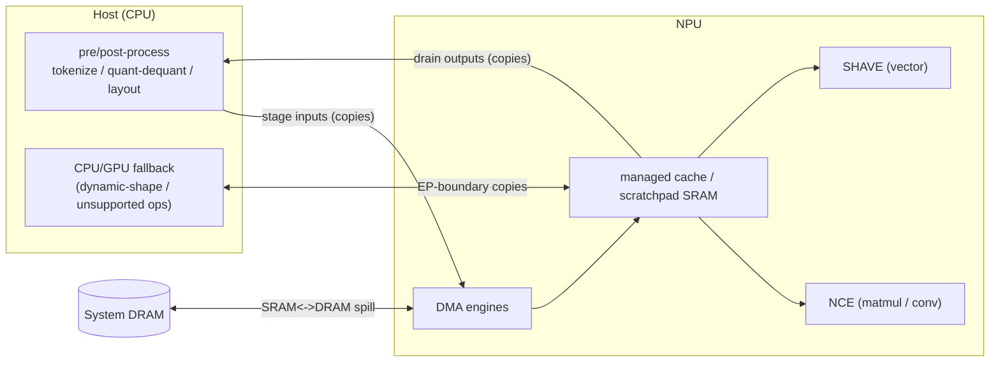
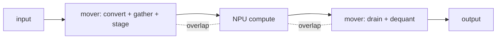
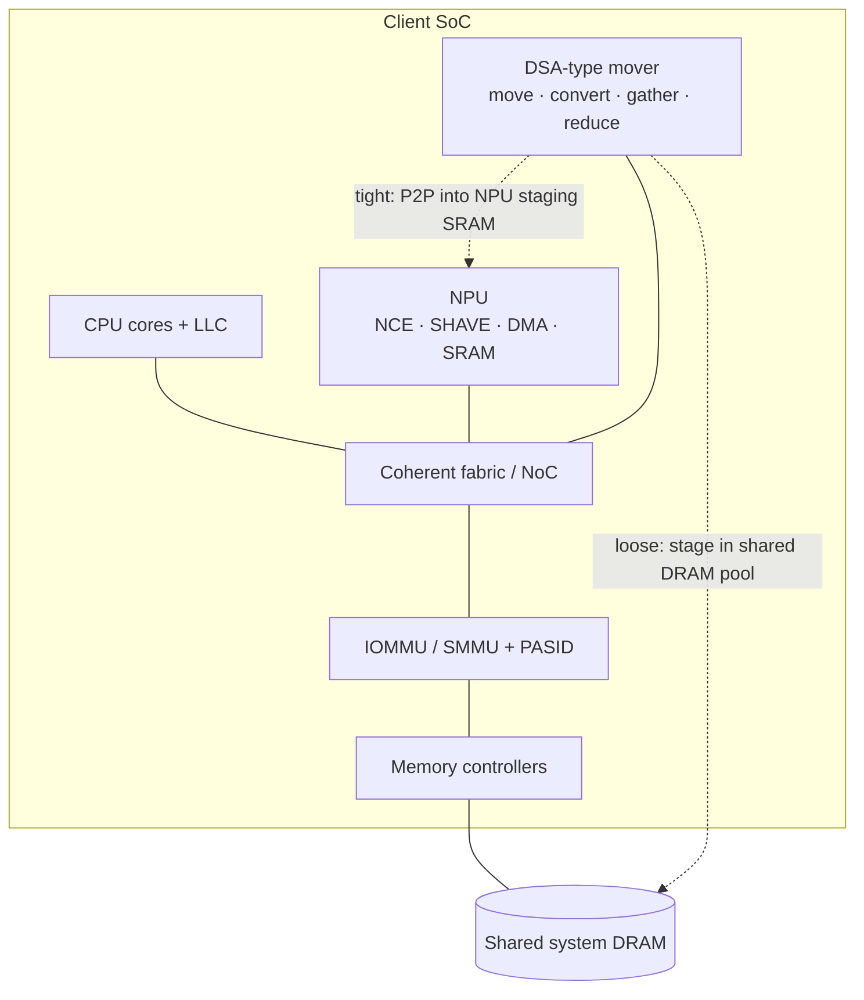

# Proposal — A Data-Streaming Mover as the NPU's Data-Plane Companion for Efficient On-Device AI Inference

> **Tracked in the private repo** (`fantops/silicon-val-prep`, private + 2FA). Public-source only — **no Intel-internal data**.
> Near-term (Aug 7) concept proposal. Companion: [`experiment_plan_npu_dataplane.md`](experiment_plan_npu_dataplane.md) (how we prove it) · [`proposal_dec2026_draft.md`](proposal_dec2026_draft.md) (Dec long paper).
> NPU facts: public — Intel NPU Acceleration Library + OpenVINO NPU docs. Mover op vocabulary: public Intel DSA spec (341204-006US, Rev 3.0).

---

## Abstract

On-device AI inference is increasingly limited not by neural **compute** but by the **data plane** that surrounds it — quantize/dequantize, tensor layout conversion, embedding gathers, KV-cache movement, host↔accelerator staging copies, and fallback traffic for operations the NPU cannot run. The NPU accelerates matrix math; the *rest of the pipeline* still runs on the host CPU, burning cycles and energy and stalling the NPU while it waits to be fed. We call this the **data-plane tax**. We propose integrating a **programmable data-streaming mover** (a DSA-class engine) on the SoC as a **companion to the NPU** that offloads and overlaps this data plane. Unlike a plain DMA, the mover performs *compute-capable movement* — type conversion, scatter-gather, reduction, dual-cast — over **shared virtual memory**, so the inference runtime can hand it the data-plane work directly. We describe the NPU architecture, the exact offload opportunities, and **how such a mover fits on the SoC** (fabric placement, coherency, IOMMU/PASID, coupling to the NPU, programming model, QoS, power). We validate the *opportunity* on today's client NPUs by measurement, and outline a server (AMX+DSA) counterpart that measures the *mechanism*.

---

## 1. Problem statement

An NPU is a compute accelerator: it turns matmul/convolution into high-TOPS, low-power fixed-function work. But **end-to-end inference is a pipeline**, and the NPU only accelerates one stage of it:

```
input → pre-process → quantize/layout → stage to NPU → NPU compute → drain from NPU → dequantize → post-process → output
        └──────────────── host CPU data plane ───────────────┘        └──────── host CPU data plane ────────┘
```

The **non-compute stages run on the host CPU** and are dominated by **data movement and element-wise transforms**: image resize/normalize or tokenization, **layout conversion** (e.g., NCHW↔NHWC, tiling/blocking), **quantize/dequantize** (FP32↔FP16↔INT8), **embedding/KV gathers**, and **staging copies** across the host↔NPU boundary and DRAM↔on-chip SRAM.

Two structural properties of NPUs **amplify** this tax:

1. **Scratchpad-centric dataflow.** The NPU is engineered to keep tensors resident in on-chip **SRAM** and to *minimize SRAM↔DRAM transfers*. When the working set exceeds SRAM (large models, long context), spill/stage traffic grows — and the **host** frequently orchestrates the surrounding movement.
2. **Static-shape execution.** Current NPUs run **static shapes only**. Dynamic-shape workloads (LLM variable sequence length, variable batch) require **host-side padding/reshaping**, or **CPU/GPU fallback** for unsupported ops — and **every fallback adds cross-engine copies** and marshalling.

**Consequences:**
- **CPU cycles burned** on data-plane work contend with the application → worse responsiveness and battery on client.
- **NPU stalls**, under-utilized while it waits for the host to prepare/move data → lower *effective* TOPS.
- **Energy wasted**: general CPU cores are inefficient per byte for bulk convert/move vs a dedicated datapath; extra cache pollution and core wake-ups add power.
- The tax is **worst exactly where on-device AI is heading** — **GenAI** (LLMs, diffusion) with dynamic shapes, quantized weights, and KV-caches.

**The problem, stated:** *how do we relieve the host CPU of the AI data-plane tax and keep the NPU fed — improving inference latency, CPU availability, and energy — without enlarging the NPU itself?*

### 1.1 A concrete example — one decode step of a small LLM

Take **TinyLlama-1.1B** (≈22 layers, hidden 2048, 32k vocab), **INT4 weights / FP16 compute** — a realistic
on-device model. Generating **one token** (batch = 1 decode) runs the pipeline below; the matmul compute is a
small fraction while **data movement and transforms dominate**:

| # | Stage | Where | Data-plane work | Offloadable to mover |
|---|---|---|---|---|
| 1 | Sampled token → embedding | host + NPU | **gather** one 2048-wide row from the 32k×2048 table | **Scatter-Gather** |
| 2 | Weight streaming (per layer ×22) | host/NPU | **dequant INT4→FP16** for Wq/Wk/Wv/Wo/gate/up/down | **Type Conversion** |
| 3 | Activation packing | host/SHAVE | **layout / tiling** convert to NCE format | Type Conversion / strided Move |
| 4 | Attention | NPU + host | **KV-cache append + read** over growing context; softmax **reduce** | **Move** + **Reduce** |
| 5 | Static-shape handling | host | **pad/bucket** the dynamic seq length, or CPU **fallback** copies | **Move** |
| 6 | LM head → logits | NPU→host | drain 32k-wide logits to host | Move |
| 7 | Sample (argmax / top-k/p) | host | **reduce / partial sort** | Reduce (+ host) |
| 8 | Detokenize | host | id → text | host |

**Why this is the worst case (and the point):** at batch = 1 the matmuls are tiny, yet the step still **streams
and dequantizes ~all weights** and **moves the whole KV-cache** every token — it is **memory/data-plane bound**,
not compute bound. Stages 1–6 are exactly the mover's wheelhouse, and a static-shape NPU also forces stage 5's
pad/fallback each step. (A static CNN like MobileNet shows a *much smaller* tax — a useful contrast for the paper.)

---

## 2. Background — NPU architecture (public)

*(Intel Core Ultra NPU; Meteor Lake = NPU 3720, Lunar Lake = NPU 4. Sources: Intel NPU Acceleration Library; OpenVINO NPU device docs.)*

The Intel NPU is an integrated AI accelerator characterized by **compute acceleration + data-transfer** capabilities:

| Block | Role |
|---|---|
| **Neural Compute Engines (NCE)** | Fixed-function hardware for **matrix multiplication and convolution** — the bulk of the TOPS. |
| **SHAVE** (Streaming Hybrid Architecture Vector Engines) | Programmable **VLIW DSP / vector** cores for general and element-wise ops outside the NCE. |
| **DMA engines** | Move data between **system DRAM** and an on-die **managed cache / scratchpad SRAM**. |
| **Device MMU + IOMMU** | Address translation and security isolation. |
| **UMD compiler** | Tiles the network to keep tensors resident in **SRAM**, maximizing NCE utilization and **minimizing SRAM↔DRAM transfers**. |

- **Numerics:** hardware compute is **FP16**; supports FP32/FP16 and **INT8 (U8)** quantized (or mixed FP16-INT8).
- **Execution:** a compiled model blob with a **tiled** schedule; the driver schedules layer execution and memory transactions across NPU submodules. **Static shapes only** (current limitation). Scales via tiles (`intel_npu::tiles` / `max_tiles`).
- **Software:** **OpenVINO** NPU plugin or **DirectML**; **AUTO/HETERO** can split a model across NPU + CPU + GPU, falling back for unsupported ops.



**Key observation:** the NPU's *own* DMA handles DRAM↔SRAM for the compiled graph, but the **host CPU** still owns (a) app-level pre/post-processing, (b) quant/dequant and layout not folded into the graph, (c) **cross-engine copies** for fallback, and (d) orchestration/staging. That host-and-boundary region is the target.

---

## 3. Why the tax exists (tying arch → problem)

- The NPU is a **compute island**; the pipeline around it is **memory- and transform-bound**, and that part lands on the CPU.
- The **static-shape + scratchpad** design means dynamic/large GenAI workloads externalize work to the host: padding, reshaping, dequant of compressed weights, KV movement, and fallback copies.
- General CPU cores are the **wrong tool** for bulk, regular (and irregular-gather) data movement/convert: low bytes/joule, cache pollution, and serialized with the NPU rather than overlapped.

---

## 4. Proposed solution — a DSA-type mover as the NPU's data-plane companion

Integrate a **programmable data-streaming mover** (a **DSA-class** engine) on the SoC, positioned to **offload the host-side and boundary data plane** and to **stage/prefetch** data so the NPU stays fed.

**Why DSA-class, not a plain DMA.** A plain client iDMA can copy bytes; it cannot *transform* or be safely multi-tenant. A DSA-class engine adds exactly what the AI data plane needs (op vocabulary from the public Intel DSA spec, Rev 3.0):

| Capability | Why it matters for inference |
|---|---|
| **Type Conversion** | quant/dequant and dtype casts as *convert-on-move* (no separate CPU pass) |
| **Scatter-Gather** | embedding / KV / MoE gathers — irregular, cache-hostile on the CPU |
| **Reduce** | pooling / element-wise reductions |
| **Memory Move / Dual-cast** | staging, double-buffering, mirroring |
| **Descriptor + user-space submit** (ENQCMD/MOVDIR64B) | the runtime submits data-plane work directly, low overhead |
| **PASID / SVM (shared virtual memory)** | operate on the runtime's *virtual* buffers — no pinning, no bounce copies |
| **Faultable (PRS) + async completion** | overlap with NPU compute; tolerate demand-paged buffers |

**Mechanism.** The inference runtime (OpenVINO / DirectML / ORT) routes data-plane ops to the mover as descriptors over **shared virtual memory**; the mover executes them **overlapped** with NPU compute; completion is signaled by poll / wait / interrupt. Result: the **CPU is freed**, the **NPU is fed sooner**, and serial host stages become **overlapped** movement.



---

## 5. What it accelerates — offload map + efficiency

| NPU-adjacent data-plane pain | Mover op | Efficiency gained |
|---|---|---|
| Quant / dequant (INT8 ↔ FP16/FP32) | **Type Conversion** | frees CPU; fuse convert into the staging copy |
| Host↔NPU layout / tiling conversion | Type Conversion / strided **Move** | offload reshape/transpose copies |
| Embedding / KV / MoE gather | **Scatter-Gather** | efficient irregular access vs CPU cache misses |
| Weight streaming / activation spill staging | **Move / Dual-cast** (double-buffer) | prefetch next tile → hide memory latency, raise NCE utilization |
| Input staging / output drain (host↔NPU) | **Move** (+ SVM) | overlap with compute; no bounce buffer |
| CPU/GPU fallback & HETERO EP-boundary copies | **Move** | offload cross-engine copies forced by dynamic shapes |
| Pooling / element-wise reductions | **Reduce** | offload from CPU/SHAVE |

**Efficiency dimensions (the KPIs):**
1. **CPU cycles freed** — application responsiveness + battery.
2. **Latency** — overlap data movement with NPU compute; remove serial host stages.
3. **Energy/inference** — dedicated datapath beats general cores on bytes/joule; less cache pollution and fewer wake-ups.
4. **Effective NPU utilization** — keep the NCE fed → higher realized TOPS.

---

## After offload — what gets optimized (operation & instruction level)

Today each data-plane op runs on the CPU/SHAVE as a **loop of SIMD instructions** (loads/stores + convert +
gather + reduce), consuming core cycles and serialized ahead of / behind NPU compute. After offload, each op
becomes **one 64-byte descriptor submit** (`ENQCMD` / `MOVDIR64B`) to the mover, executed **asynchronously and
overlapped** with the NPU. The optimization is twofold: **fewer CPU dynamic instructions** and **latency hidden
under compute**.

### Instruction-level: before → after
| Data-plane op | Baseline CPU/SHAVE path (today) | After (mover) | What's optimized |
|---|---|---|---|
| Dequant INT4→FP16 | loop: load + unpack + `VCVT` + store (AVX) | 1 **Type-Conversion** descriptor | convert loop offloaded; overlaps compute |
| Embedding / KV gather | `VPGATHER` / pointer-chase loads | 1 **Scatter-Gather** descriptor | irregular loads offloaded |
| KV-cache append / read | `REP MOVS` / AVX copy | 1 **Memory Move** descriptor | copy offloaded; overlapped |
| Layout / tiling convert | transpose load/store loops | Type-Conversion / strided **Move** | transpose offloaded |
| Host↔NPU staging | `memcpy` (+ bounce buffer) | **Move** over SVM | copy offloaded; no bounce buffer |
| Softmax / pooling stats | AVX reduce loops | **Reduce** | reduction offloaded |
| Sampling reduce | partial-sort / argmax | Reduce (+ host tail) | partial offload |

**Instruction-count view:** a data-plane op that is an *N*-instruction CPU loop collapses to **~1 submit + 1
completion check**; the mover performs the *N*-equivalent work on a dedicated datapath, in parallel with the NCE.

### Data points to fill (measured — you provide)
Per op, per token — from the [experiment plan](experiment_plan_npu_dataplane.md) (client baseline) + a server DSA microbench (mover cost):

| Op | Bytes/token | Baseline CPU cycles | Baseline energy (mJ) | Mover time (µs) | Overlap % | Freed CPU cycles |
|---|---|---|---|---|---|---|
| Dequant INT4→FP16 | `<TBD>` | `<TBD>` | `<TBD>` | `<TBD>` | `<TBD>` | `<derived>` |
| Embedding / KV gather | `<TBD>` | `<TBD>` | `<TBD>` | `<TBD>` | `<TBD>` | `<derived>` |
| KV-cache move | `<TBD>` | `<TBD>` | `<TBD>` | `<TBD>` | `<TBD>` | `<derived>` |
| Layout convert | `<TBD>` | `<TBD>` | `<TBD>` | `<TBD>` | `<TBD>` | `<derived>` |
| Host↔NPU staging | `<TBD>` | `<TBD>` | `<TBD>` | `<TBD>` | `<TBD>` | `<derived>` |
| **Total** | | `Σ` | `Σ` | | | `Σ = C_dp` |

### Analytical model (fill once data lands)
- Baseline per-token latency:  `T_base = t_compute + Σ t_i(dp)`   (data-plane stages serial with compute)
- Freed CPU cycles:  `C_dp = Σ c_i(dp)`   (offloaded ops' baseline cycles)
- After overlap:  `T_opt ≈ max( t_compute , Σ t_i(mover) ) + t_host_residual`
- Speedup:  `S = T_base / T_opt` ;  energy saved ≈ `E_cpu(dp) − E_mover`
- Instruction reduction:  CPU data-plane dynamic instructions  `Σ N_i  →  ≈ (#ops) submits`

> **Next:** you provide the measured `<TBD>` cells → we finalize the model, compute S and energy saved, and
> build the before/after figure. The experiment plan's P2/P3 phases produce these exact numbers.

---

## 6. How it fits on the SoC (integration)

The mover is a **fabric-attached data-streaming engine** placed alongside the NPU, CPU, and memory controllers — analogous to how a server DSA sits as an integrated endpoint on the mesh with IOMMU access.



**6.1 Placement & bandwidth.** On the **coherent fabric / NoC**, with high-bandwidth access to the memory controllers (and ideally a path toward the NPU's staging region). It must sit where it can see both **host buffers** and the **NPU ingress**.

**6.2 Memory & coherency.** The mover should be **coherent** with CPU caches (so offloaded convert/move stays consistent with app/runtime data), or provide explicit **cache-control** semantics where coherence is relaxed. Coherence keeps the SVM programming model clean.

**6.3 IOMMU / PASID / SVM.** The mover shares the **IOMMU/SMMU** and carries a **PASID**, so it operates on the **runtime's virtual addresses** directly — **no pinning, no bounce buffers**. This is what makes it usable from a user-space inference runtime rather than a kernel-only DMA.

**6.4 Coupling to the NPU — two integration tiers:**
- **Loose (near-term, no NPU redesign):** mover and NPU are independent fabric agents. The runtime orchestrates: mover prepares/stages/converts data into a **shared DRAM pool**, signals completion; the NPU's own DMA pulls into SRAM. Benefit with minimal SoC change.
- **Tight (future):** mover writes **peer-to-peer into the NPU's staging SRAM** (or a **shared staging SRAM** pool), enabling *convert-on-the-way-in* and **true double-buffering** of NCE tiles. Requires NPU-side support (an ingress port / mailbox / shared-buffer handshake).

**6.5 Programming model.** Exposed as a device with **user-space descriptor submission** (ring + doorbell). Integrated into the runtime as a **data-plane offload path** (e.g., an OpenVINO/ORT pre/post + staging hook, or a DirectML metacommand). Descriptors carry op, virtual src/dst (via PASID), shapes/strides, and completion; **async** completion overlaps with NPU inference requests.

**6.6 QoS & scheduling.** The mover shares memory bandwidth with the CPU and NPU. It needs **QoS / bandwidth controls** (group/bandwidth limits, priorities) so offload + overlap is a **net win** and it never **starves the NPU** of DRAM bandwidth — a real constraint on bandwidth-limited client SoCs.

**6.7 Power.** Power-gated when idle; its per-byte energy for convert/move/gather must **beat the CPU** doing the same. On client, **energy is the headline metric**, so this is a gating design requirement, not an afterthought.

**6.8 Integration cost / tradeoffs (stated honestly).** Added silicon area; fabric/coherency and IOMMU complexity; potential **memory-bandwidth contention**; and non-trivial **software-stack work** to route data-plane ops to the mover. Today a DSA-class engine ships on **server (Xeon)**, not on client SoCs — so this is a **forward-looking client-SoC integration proposal**, motivated by measuring the opportunity on current NPUs.

---

## 7. Evaluation plan (summary)

- **Client (opportunity, measurable now):** on a Core Ultra NPU laptop, profile the **host data-plane fraction** of end-to-end inference (OpenVINO), CNN vs LLM, and estimate the mover's freed-cycles / latency / energy benefit. Full protocol: [`experiment_plan_npu_dataplane.md`](experiment_plan_npu_dataplane.md).
- **Server (mechanism, measured later):** on a DSA-capable Xeon with **AMX** as the compute engine, offload one data-plane op (dequant→Type-Conversion, embedding→Scatter-Gather, KV→Move) to a real **DSA** and measure freed cycles / tokens-per-second / energy. The client measures the *opportunity*; the server measures the *mechanism*.

---

## 8. Expected contributions

1. **Quantify** the on-device inference **data-plane tax** on a current client NPU (CNN vs LLM).
2. A concrete **architecture**: a DSA-type mover as the NPU's data-plane companion, with **SoC integration options** (loose vs tight coupling).
3. An **offload taxonomy** mapping AI data-plane ops → mover ops.
4. A **research/validation agenda** (correctness of convert/gather/reduce; QoS; energy) bridging to the long paper.

---

## 9. Risks & limitations

- **Platform:** DSA-class movers are server-only today → client integration is a proposal; the client benefit is **estimated** (opportunity measured, mechanism modeled).
- **Bandwidth:** on shared-DRAM client SoCs the mover must be net-positive, not just added traffic.
- **Profiling:** NPU per-op counters are coarse → rely on host stage-level timing.
- **Software:** realizing the benefit needs runtime integration (OpenVINO/ORT/DirectML).

---

## 10. Related work (to differentiate — verify before submission)

- Datacenter / microservice "tax": data movement dominates cycles (Kanev et al., ISCA 2015).
- DSA characterization on Xeon: memcpy/dedup/DPDK/SPDK (Rev 1/2-era studies).
- NPU/accelerator inference: OpenVINO/DirectML NPU execution; heterogeneous EP scheduling.
- **Gap claimed:** NPU **host-side data-plane tax** + a **DSA-class mover** as an on-SoC companion, with **client** on-device-GenAI framing, is under-covered.

---

## Sources
- Intel NPU Acceleration Library — NPU architecture description (github.com/intel/intel-npu-acceleration-library).
- OpenVINO — NPU device documentation (docs.openvino.ai).
- Intel Data Streaming Accelerator Architecture Specification, Rev 3.0 (341204-006US) — mover operation vocabulary.
