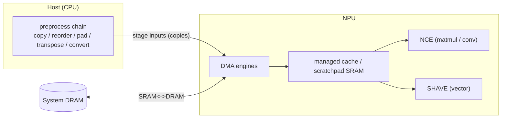
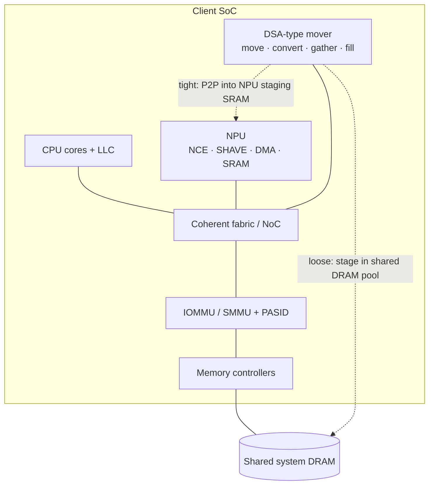

# Proposal — An AI Tensor-Preprocessing Accelerator: offloading the pre-inference data plane to a DSA-type mover (Intel NPU)

> **Tracked in the private repo** (`fantops/silicon-val-prep`, private + 2FA). Public-source only — **no Intel-internal data**.
> Near-term (Aug 7) concept proposal. Companion: [`experiment_plan_npu_dataplane.md`](experiment_plan_npu_dataplane.md) (how we prove it) · [`proposal_dec2026_draft.md`](proposal_dec2026_draft.md) (Dec long paper).
> NPU facts: public — Intel NPU Acceleration Library + OpenVINO NPU docs. Mover op vocabulary: public Intel DSA spec (341204-006US, Rev 3.0).

---

## Abstract

Everyone optimizes the AI accelerator; almost nobody optimizes the **preprocessing** that feeds it. Before an
NPU ever runs, the host CPU executes a serial chain of tensor plumbing — **copy, reorder, pad, transpose,
datatype-convert** — and stages the result into the accelerator's buffers. For small-batch, latency-sensitive
on-device inference this preprocessing is a real fraction of end-to-end time and CPU energy, and it **stalls
the NPU** while the host prepares data. We propose an **AI tensor-preprocessing accelerator**: a **DSA-type
data-streaming mover** that executes the preprocessing chain as a **single submitted descriptor batch**, over
shared virtual memory, **overlapped** with NPU compute. The CPU merely submits a descriptor; the mover does the
copy/reorder/pad/transpose/convert and notifies the NPU. We ground this on the **Intel** NPU (Core Ultra) with
**Intel DSA** as the concrete mover, map each preprocessing op to a mover primitive, describe how such a mover
fits on the SoC, and measure the preprocessing tax on today's Intel client NPUs to size the opportunity.

---

## 1. Problem statement

**Everyone talks about the AI accelerator. Almost nobody talks about the preprocessing.**

An NPU accelerates matmul/convolution — but an inference request first runs a **host-side preprocessing chain**
before the accelerator does anything:

```
input → copy → reorder → pad → transpose → datatype-convert → stage to NPU → [ NPU compute ] → ...
        └──────────────── serial CPU tensor plumbing ────────────────┘
```

Each step is a **loop of loads/stores/convert** on the CPU: format the tensor to the layout/precision the NPU
expects, pad to a static shape, transpose to the required data order, cast FP32→FP16/INT8, then copy into the
NPU-visible buffer. This work:
- runs **serially before** compute — the NPU waits to be fed;
- **burns CPU cycles and energy** and **pollutes caches**;
- is **proportionally worst for small-batch / latency-sensitive** inference, where compute is short so the
  plumbing dominates.

Two NPU realities push this onto the host:
1. **Static shapes only** → the host must **pad/reshape** dynamic inputs to a fixed shape (or fall back to CPU/GPU).
2. **Scratchpad-centric dataflow** → the NPU wants tensors in a specific **tiled layout/precision**, so the host
   does the **convert / transpose / pack** to match.

**The problem, stated:** *how do we take the pre-inference tensor-plumbing chain off the CPU — cutting latency,
CPU utilization, and cache pollution — and keep the NPU fed, without enlarging the NPU?*

### 1.1 A concrete example — a small model, one inference

Take a small vision model (e.g., **MobileNetV2 / ResNet-50, INT8**), one image. Before the NPU runs a single MAC:

| Stage | Where | Data-plane work | Mover primitive |
|---|---|---|---|
| decode + resize + normalize | CPU | pixels → tensor, scale/mean | (decode) + Memory Move |
| layout NCHW → NPU tiled format | CPU | **reorder / transpose** | Scatter-Gather / strided Move |
| quantize FP32 → INT8 | CPU | **datatype convert** | Type Conversion |
| pad to static shape | CPU | **pad** | Fill |
| stage into NPU buffer | CPU | **copy** | Memory Move |
| inference | **NPU** | matmul / conv | — |

For a latency-sensitive request the **top five rows (preprocessing) are a real fraction** of end-to-end time
and CPU energy — the compute is short, so the plumbing shows. For an **LLM** decode (e.g., TinyLlama-1.1B,
INT4) the same plumbing **recurs every token** (tokenize, embedding **gather**, weight **dequant**, KV-cache
**move**), so at batch = 1 the step is **memory/data-plane bound**, not compute bound (see the extension in §3).

---

## 2. Background — NPU architecture (public)

*(Intel Core Ultra NPU; Meteor Lake = NPU 3720, Lunar Lake = NPU 4. Sources: Intel NPU Acceleration Library; OpenVINO NPU docs.)*

| Block | Role |
|---|---|
| **Neural Compute Engines (NCE)** | Fixed-function hardware for **matrix multiply and convolution** — the bulk of the TOPS. |
| **SHAVE** (Streaming Hybrid Architecture Vector Engines) | Programmable **VLIW DSP / vector** cores for general / element-wise ops. |
| **DMA engines** | Move data between **system DRAM** and an on-die **managed cache / scratchpad SRAM**. |
| **Device MMU + IOMMU** | Address translation and isolation. |
| **UMD compiler** | Tiles the network to keep tensors resident in **SRAM**, minimizing SRAM↔DRAM transfers. |

- **Numerics:** HW compute is **FP16**; supports FP32/FP16 and **INT8 (U8)** quantized (or mixed).
- **Execution:** compiled, **tiled** blob; **static shapes only**; scales via tiles. Programmed via **OpenVINO**
  NPU plugin or **DirectML**; **AUTO/HETERO** can split across NPU + CPU + GPU (fallback for unsupported ops).



**Why the host does the plumbing:** the NPU's DMA moves data for the *compiled graph*, but **static shapes** and
the **tiled layout/precision** the NCE expects mean the **host** must convert/transpose/pad/stage the input first.

---

## 3. Proposed solution — the preprocessing accelerator (a DSA-type mover)

Introduce a **DSA-type data-streaming mover** whose job is the **pre-inference tensor-plumbing chain**. Instead
of the CPU running `for(...)` loops, the runtime builds a **descriptor chain** and submits it **once**:

```
  CPU today (per tensor):        With the mover (one submit):
  for(...) copy                  build a descriptor batch:
  for(...) reorder                 read -> transpose(strided) -> pack(gather) -> pad(fill) -> convert -> stage
  for(...) pad                   one ENQCMD  ->  mover runs the chain, overlapped with the NPU
  for(...) transpose             mover writes completion / notifies the NPU
  for(...) convert
```

**The CPU merely submits the descriptor.** The mover executes the chain over **shared virtual memory** (PASID /
SVM — no pinning, no bounce buffer), **overlapped** with NPU compute, and signals completion by record / doorbell.

**Why a DSA-class engine, not a plain DMA.** It does *compute-capable* movement and is **user-submittable**:

| Capability | Use in the preprocessing chain |
|---|---|
| **Type Conversion** | datatype cast (FP32→FP16/INT8) |
| **Scatter-Gather** | reorder / pack into the NPU's tiled layout |
| **Fill** | pad to static shape |
| strided **Memory Move** | transpose / copy / stage |
| **Batch descriptor** (`Fence` for order) | the whole chain, submitted as one unit |
| **`ENQCMD` / `MOVDIR64B`** | user-space submit — "CPU merely submits" |
| **PASID / SVM** | operate on the runtime's buffers — no pinning, no bounce |

A plain client iDMA can copy bytes but cannot convert / gather / pad, chain, or be safely multi-tenant.

### Preprocessing op → mover primitive
| Preprocessing step | Mover primitive | Note |
|---|---|---|
| Copy tensor | **Memory Move** | direct |
| Reorder / pack | **Scatter-Gather** | into packed / tiled layout |
| Pad | **Fill** (+ Move) | pad region = Fill pattern |
| Transpose | **strided Memory Move** | via strides (no named transpose op) |
| Datatype convert | **Type Conversion** | Rev 3.0 |
| The chain | **Batch descriptor** (`Fence`) | one `ENQCMD` submits it |
| Notify | completion record / doorbell | poll / interrupt |

> **Extension (same mechanism):** the descriptor-chain approach carries past preprocessing to the **in-inference**
> data plane — weight **dequant** (Type Conversion), **KV-cache** movement (Move), embedding **gather**
> (Scatter-Gather), and **output** drain + dequant. Preprocessing is the sharp, relatable anchor; the mover
> generalizes to the whole host data plane.

---

## 4. After offload — what gets optimized (operation & instruction level)

Today each preprocessing op runs on the CPU/SHAVE as a **loop of SIMD instructions** (loads/stores + convert +
gather), consuming core cycles serialized ahead of NPU compute. After offload, each op becomes **one 64-byte
descriptor** in a batch, executed **asynchronously and overlapped**. The optimization is twofold: **fewer CPU
dynamic instructions** and **latency hidden under compute**.

### Instruction-level: before → after
| Preprocessing op | Baseline CPU/SHAVE path (today) | After (mover) | What's optimized |
|---|---|---|---|
| Datatype convert (FP32→FP16/INT8) | loop: load + `VCVT` + store (AVX) | 1 **Type-Conversion** descriptor | convert loop offloaded; overlaps |
| Reorder / pack | `VPGATHER` / strided loads | 1 **Scatter-Gather** descriptor | irregular access offloaded |
| Pad | fill loop / `memset` | 1 **Fill** descriptor | pad offloaded |
| Transpose | transpose load/store loops | strided **Memory Move** | transpose offloaded |
| Copy / stage to NPU | `memcpy` (+ bounce buffer) | **Memory Move** over SVM | copy offloaded; no bounce |

**Instruction-count view:** the whole chain (an *N*-instruction CPU sequence) collapses to **~1 batch submit + 1
completion check**; the mover does the *N*-equivalent work on a dedicated datapath, in parallel with the NCE.

### Data points to fill (measured — you provide)
Per op, per inference — from the [experiment plan](experiment_plan_npu_dataplane.md) (client baseline):

| Op | Bytes | Baseline CPU cycles | Baseline energy (mJ) | Mover time (µs) | Overlap % | Freed CPU cycles |
|---|---|---|---|---|---|---|
| Datatype convert | `<TBD>` | `<TBD>` | `<TBD>` | `<TBD>` | `<TBD>` | `<derived>` |
| Reorder / pack | `<TBD>` | `<TBD>` | `<TBD>` | `<TBD>` | `<TBD>` | `<derived>` |
| Pad | `<TBD>` | `<TBD>` | `<TBD>` | `<TBD>` | `<TBD>` | `<derived>` |
| Transpose | `<TBD>` | `<TBD>` | `<TBD>` | `<TBD>` | `<TBD>` | `<derived>` |
| Copy / stage | `<TBD>` | `<TBD>` | `<TBD>` | `<TBD>` | `<TBD>` | `<derived>` |
| **Total** | | `Σ` | `Σ` | | | `Σ = C_pp` |

### Analytical model (fill once data lands)
- Baseline latency:   `T_base = t_compute + Σ t_i(preproc)`   (chain serial before compute)
- Freed CPU cycles:   `C_pp = Σ c_i(preproc)`
- After overlap:      `T_opt ≈ max( t_compute , t_chain(mover) ) + t_host_residual`
- Speedup:            `S = T_base / T_opt` ;  energy saved ≈ `E_cpu(preproc) − E_mover`
- Instruction reduction:  CPU preprocessing instructions  `Σ N_i  →  ≈ 1 batch submit`

> **Next:** you provide the measured `<TBD>` cells → we finalize the model, compute S and energy saved, and build
> the before/after figure. The experiment plan's P2/P3 phases produce these numbers.

---

## 5. How it fits on the SoC (integration)

The mover is a **fabric-attached data-streaming engine** placed alongside the NPU, CPU, and memory controllers.



- **Placement & bandwidth:** on the **coherent fabric / NoC**, with high-bandwidth access to the memory
  controllers and a path toward the NPU ingress.
- **Coherency:** **coherent** with CPU caches (keeps offloaded convert/move consistent with app data), or explicit
  cache-control where coherence is relaxed.
- **IOMMU / PASID / SVM:** shares the IOMMU and carries a **PASID** → operates on the runtime's **virtual**
  buffers (no pinning, no bounce). This is what makes it usable from a user-space inference runtime.
- **Coupling to the NPU — two tiers:**
  - **Loose (near-term, no NPU redesign):** mover stages/converts into a **shared DRAM pool**, signals; the NPU's
    own DMA pulls into SRAM.
  - **Tight (future):** mover writes **peer-to-peer into the NPU staging SRAM** for *convert-on-the-way-in* and
    double-buffering; needs an NPU ingress/handshake.
- **Programming model:** user-space **descriptor batch** submission integrated into the runtime (an OpenVINO/ORT
  preprocessing hook or a DirectML metacommand); **async** completion overlaps with the inference request.
- **QoS & power:** **bandwidth/QoS controls** so the mover never starves the NPU of DRAM bandwidth; **power-gated**
  when idle — its bytes/joule for convert/move/pad must beat the CPU (on client, energy is the headline metric).
- **Integration cost (honest):** added area; fabric/coherency + IOMMU complexity; memory-bandwidth contention;
  and runtime-integration work. **Today a DSA-class engine ships on server (Xeon), not on client SoCs** — so this
  is a **forward-looking client-SoC integration proposal**, motivated by measuring the opportunity on current NPUs.

---

## 6. Evaluation (Intel Core Ultra client)

Evaluated on **Intel Core Ultra** client hardware: profile the **preprocessing (host data-plane) fraction** of
end-to-end inference (OpenVINO), for a static CNN and a dynamic LLM, and estimate the mover's freed-cycles /
latency / energy benefit. Full protocol: [`experiment_plan_npu_dataplane.md`](experiment_plan_npu_dataplane.md).

> Out of scope for this proposal: the *measured* server-side mechanism (AMX compute + a real DSA on Xeon) is the
> separate [Dec-2026 paper](proposal_dec2026_draft.md).

---

## 7. Contributions

1. **Name and quantify** the pre-inference **preprocessing tax** on a client NPU (static CNN vs dynamic LLM).
2. **The preprocessing-accelerator concept:** a DSA-type mover that runs the tensor-plumbing chain as a **single
   submitted descriptor batch** — "the CPU merely submits."
3. **An op→primitive mapping** (copy/reorder/pad/transpose/convert → Move/Scatter-Gather/Fill/Type-Conversion).
4. **SoC integration** options (loose vs tight coupling) and the QoS/coherency/PASID requirements.
5. A **research agenda** extending the same descriptor-chain to the full in-inference data plane.

---

## 8. Risks & limitations

- **Platform:** DSA-class movers ship on server today → client integration is a proposal; the client benefit is
  **estimated** (opportunity measured, mechanism modeled).
- **No named transpose:** transpose/reorder is a **strided move / gather**, not a dedicated op — state it plainly.
- **Bandwidth:** on shared-DRAM client SoCs the mover must be net-positive, not just added traffic.
- **Profiling:** NPU per-op counters are coarse → rely on host stage-level timing.
- **Software:** the benefit needs runtime integration (OpenVINO / ORT / DirectML).

---

## 9. Related work (to differentiate — verify before submission)

- Datacenter / microservice "tax": data movement dominates cycles (Kanev et al., ISCA 2015).
- DSA characterization on Xeon: memcpy/dedup/DPDK/SPDK (Rev 1/2-era studies).
- Input-pipeline bottlenecks in training (e.g., data-loading/"DALI"-style preprocessing offload to GPU).
- OpenVINO / DirectML NPU execution; heterogeneous EP scheduling and CPU fallback cost.
- **Gap claimed:** an on-SoC **DSA-class preprocessing mover** for **client NPU** inference, with a descriptor-chain
  programming model, is under-covered.

---

## Sources
- Intel NPU Acceleration Library — NPU architecture description (github.com/intel/intel-npu-acceleration-library).
- OpenVINO — NPU device documentation (docs.openvino.ai).
- Intel Data Streaming Accelerator Architecture Specification, Rev 3.0 (341204-006US) — mover operation vocabulary.
